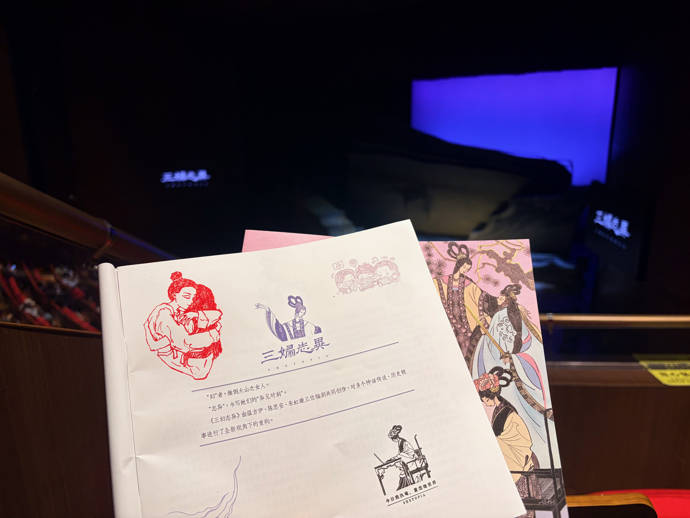
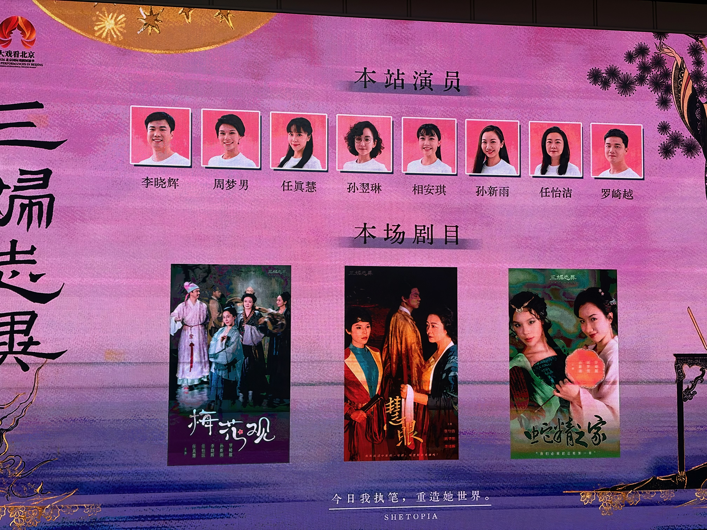
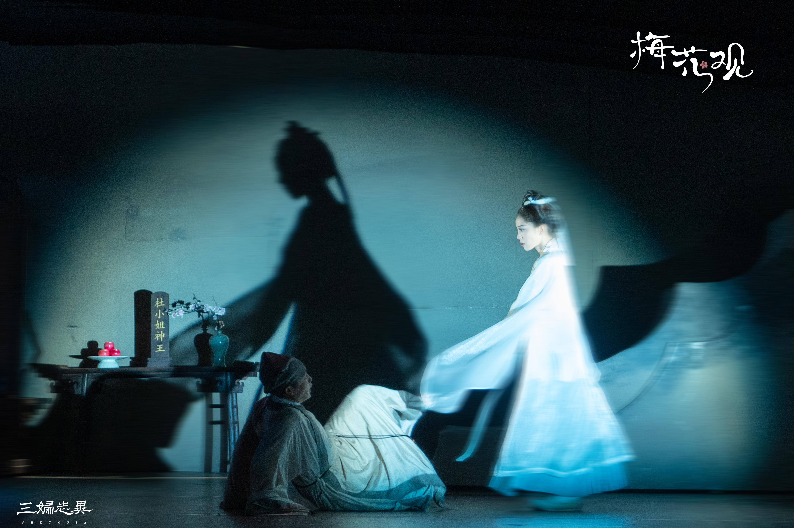
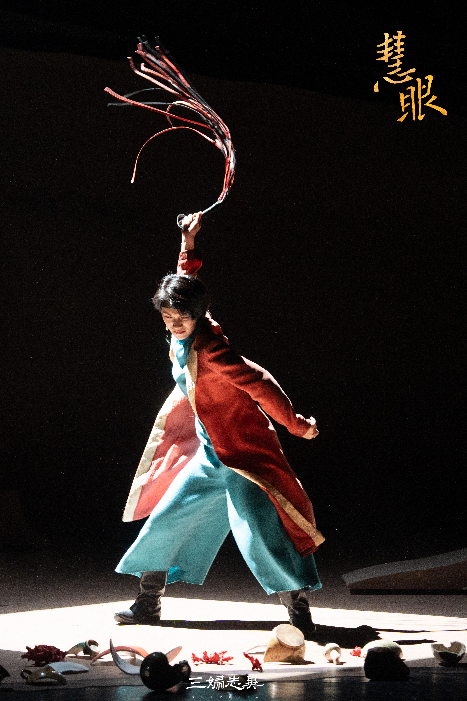
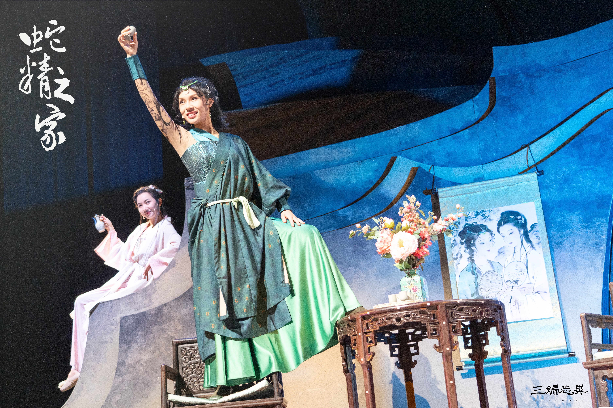
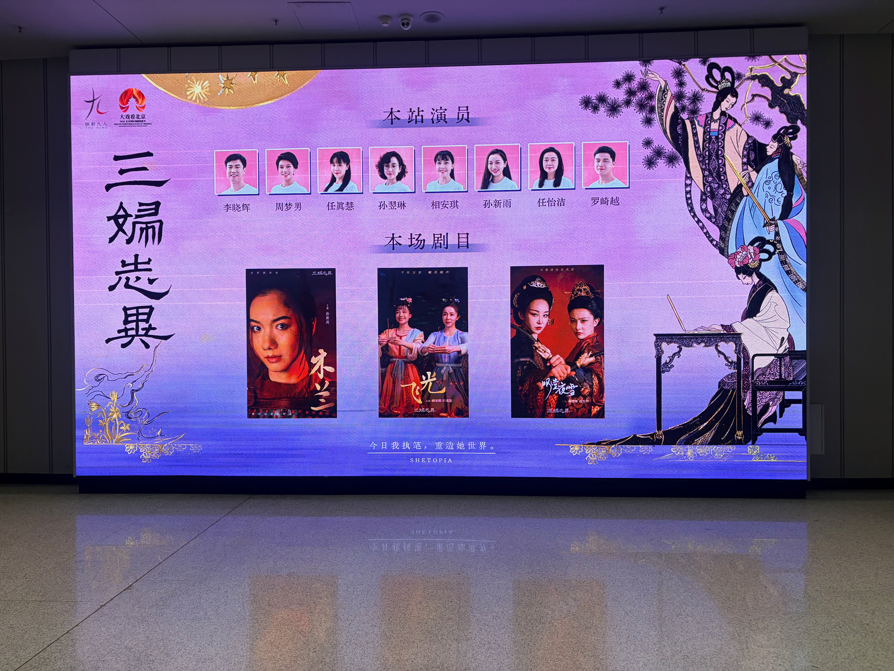
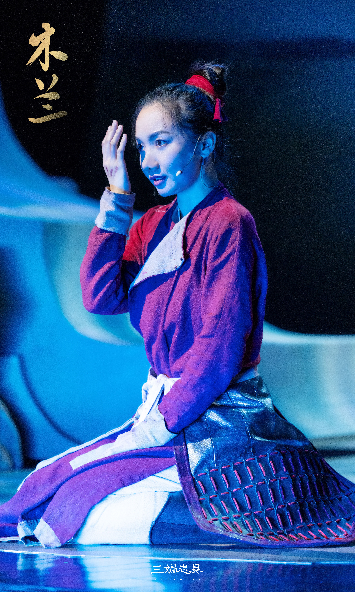
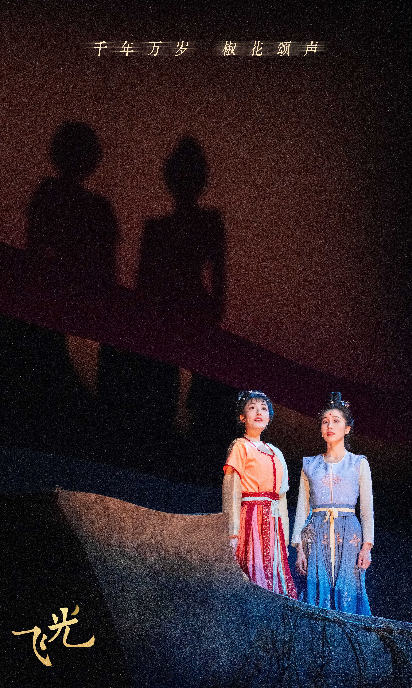
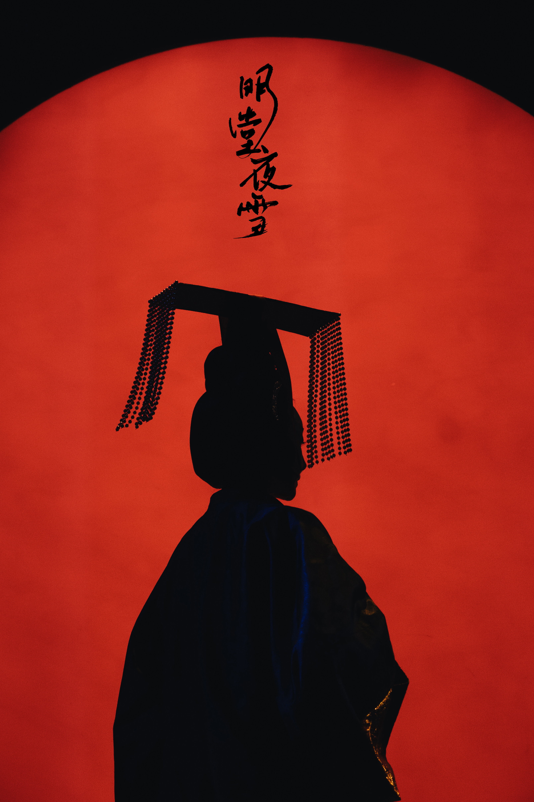

今日我执笔，重造她世界

“妇”者，推倒大山的女人。
  

“志异”，书写她们的“异见时刻”。

## 《梅花观》7/10

看到中间时，一直很好奇故事最后会落在哪里。无论是东岳夫人对恋爱脑的鄙夷，还是梦梅、丽娘为色相所迷，都不太能让我赞同。

> 我觉得（现在）这是一个很有意思的时代。一方面“恋爱脑”是被嘲讽和批判的对象，爱情的价值被重新审视；另一方面，一部分网络言情文学的读者对角色的爱情观有非常苛刻的要求。无论是哪个方面，道德都沉重地压在人们的心头。  
《[牡丹亭](https://zh.wikipedia.org/wiki/%E7%89%A1%E4%B8%B9%E4%BA%AD)》看似是一个不属于这个时代的作品，但我感觉其与这个将爱情视为束缚而非解放的时代有一种微妙的关联。汤显祖在写《牡丹亭》时有意地拿捏杜丽娘行动的分寸，她在某些时刻超越了所处时代的道德，又适时地回归到道德中去，似乎“做人”就必然进入到不自由的境地，这令我一直有个疑问：“她为什么回生？”  
如果追求完美，那么杜丽娘不会选择回到人世，主动扛起道德的枷锁。爱也是如此，要追求完美的爱，便无法爱上活人。那么我们为何而活、为何而爱？这没有固定的答案，但我很想聊聊。  
—— 编剧 [温方伊](https://baike.baidu.com/item/%E6%B8%A9%E6%96%B9%E4%BC%8A/6575247)

最后丽娘说，人活一次，应当为自己活；同时，她也对柳公子绝非完美之人有所预期。似乎算是一个可以接受的答案，只是没什么惊喜。不过，作为对经典的现代解读，也算无功无过吧。

## 《慧眼》&《蛇精之家》6/10

《慧眼》的开场音乐和定点 pose 挺酷的。除此之外，即便作为对经典的新编视角，在现如今也比较乏善可陈了。甚至没有让我像看《梅花观》时一样，对故事的落点产生好奇心……情节展开真的都在预期之内，可能是介绍写得太直白感觉被剧透了王宝钏视角以及结尾有点太ooc了

《蛇精之家》最后结尾关于小青的身份还是挺惊喜的。发现午场三则都是温方伊编剧的，难怪都是经典的后现代解读风格而且有些冷幽默。

---

## 《木兰》7/10

好久没看独角戏了，孙新雨太厉害了！！好喜欢她！！就是一直举着望远镜，手实在太酸了😂

独角戏的形式本身对观众也是一种考验，长时间保持专注并不容易。里面说木兰的一半脸是男人，一半脸是女人，让我想起之前听女性编剧创作谈时朱虹璇说“伟大的灵魂都是雌雄同体的。”

后来发现这一则是[陈思安](https://www.chensi-an.com/)自编自导，难怪我看得累。她的戏我还没看过特别喜欢的，但是我很喜欢她这个人以及她的语言表达！

## 《飞光》8/10 &《明堂夜雪》9/10

这两部真的看得望远镜橡胶圈上全是我的泪痕🥲 5月江百出了婉平画池我还在说要是下次回国能看上《飞光》和《明堂夜雪》就好了 哇心想事成！

《飞光》结尾姐妹二人互相说今后要给对方写[墓志铭](https://baike.baidu.com/item/%E4%B8%8A%E5%AE%98%E5%A9%89%E5%84%BF%E5%A2%93%E5%BF%97%E9%93%AD/12808072)流传给后世对抗史书权欲熏心大逆不道秽乱后宫叙事 [太平](https://zh.wikipedia.org/wiki/%E5%A4%AA%E5%B9%B3%E5%85%AC%E4%B8%BB)还要为[婉儿](https://zh.wikipedia.org/wiki/%E4%B8%8A%E5%AE%98%E5%A9%89%E5%84%BF)出[文集](https://zh.wikipedia.org/wiki/%E4%B8%8A%E5%AE%98%E5%A9%89%E5%84%BF#cite_note-26)的情节真好哭！**只有女性掌权者才能真正体察和改变女性处境。**

之前对相安琪的印象，是她演少女这样最贴近她本人的角色很合适，但也没有觉得演技特别惊艳。这次看完这两部戏，刮目相看了！少女的天真或懵懂，被识破身份时倏然转变的威严，还有曌儿的困惑与坚定，都让人印象很深。她真的好适合太平的明艳啊，我现在脑补的太平都不是周迅的脸，是她的脸了！而且透过望远镜，真的在两部戏里都看到了她眼中闪烁的泪光。感觉好的演员要有非常强的共情力，无论重演过多少次，每一次都依然是全新的、与角色的共振。或许女演员的魅力，也需要这些以女性为主角的作品，给她们展现的机会。

之前因为《[晚安，妈妈](https://baike.baidu.com/item/%E6%99%9A%E5%AE%89%EF%BC%8C%E5%A6%88%E5%A6%88/63097313)》认识了孙翌琳，不过我不怎么喜欢那部剧。这次发现，她演的[武曌](https://zh.wikipedia.org/wiki/%E6%AD%A6%E5%88%99%E5%A4%A9)还挺符合我想象中那个孤独的、前无古人的女帝形象。看着舞台上的她，会觉得历史上的成功女人们，多半仍是权力的宠儿，而武曌是权力本身。

《飞光》和《明堂夜雪》都有很强的[朱虹璇](https://www.yixi.tv/h5/speech/994/)的笔力和气质难怪对我胃口，再加上角色的故事本来就非常吸引人非常“觉醒“，可能也是观感最好的原因。遗憾我脑子笨，那么精彩的台词记不下来，记得最清楚的恐怕就是让全场哄堂大笑的那句。武曌死了丈夫后说——

> “我是失去了李治，又不是失去了——“（指指脑子）“理智。” 😂

其余的原句已经记不清了，但想要表达的意思散场之后一直留在心中：
> 女人是世界上最好用的奴隶。

> 少女武曌问，如果去了长安还是只能嫁人怎么办？  
—— 在唯一可行的规则和出路之下所做的选择，是不会被鄙夷的。

> 提问是一切的开端。

> 时间不是敌人，是最后的盟友。

> 不要消失在风里。

如果明年有这次没看上的《踵火》，或者新的三妇作品，我还愿意重刷《飞光》和《明堂夜雪》这两个故事，也是以后如果有孩子，无论男女都想带ta来看的剧哈哈哈～希望每次回国，都能赶上这么好看的剧！（去年是赶上了[**大！状！王！**](https://www.westk.hk/tc/theimpossibletrial-houseprogramme)

三位女性编剧风格各不相同，发现自己还是更偏爱朱虹璇那种强文本的戏。即便这样的表达也会被批评有些喊口号或类似檄文，不过完成这个水准的剧本也需要很强的思辨能力、人文知识储备，以及把这些知识真正运用起来的能力。

今年在我自身所处的领域能看到AI能力越来越强，也时常感到一些无力、挫败，和懒惰。但至少在我目前看到的作品里，戏剧文学创作、舞台美术设计和表演艺术真的是AI远远不及的领域，依然非常打动人心，也尤为珍贵。

于是忽然想起高中政治课上讲社会主义社会的设想是当物质极大丰富时，人们不再需要为了赚钱而工作，只需要把时间花在自己真正热爱的事情上时我所想象的未来，似乎就是这些文学和艺术创作的领域啊。虽然AI目前带来的更多还是人类如何维系自身赚钱能力的危机，但至少在这些我真心热爱的事情上，令人欣慰的是手搓还无法被AI替代。可惜自己也没有选择这条职业道路，好像只剩下作为观众的热爱了😂 但谁又知道未来会如何发展呢？还是要笔耕不辍地创作下去啊！
> 不要对今天抱有期待 时间不是敌人 是最后的盟友  
不要消逝在风里