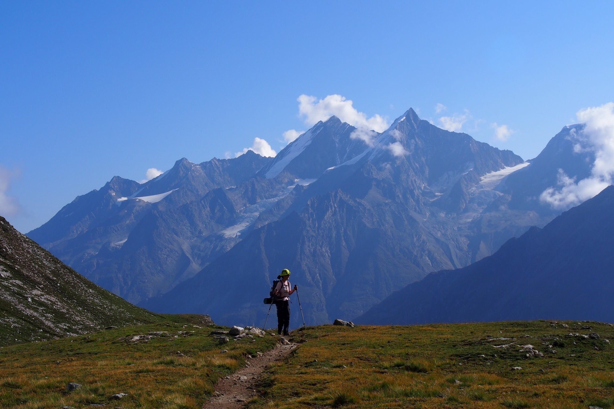

Hi, I'm Xinmeng! 🙋🏻‍♀️

I'm a Technical Business Analyst specializing in Data & AI 👩🏻‍💻 / Wanderer ⛰️ / Lover of History, Arts & Humanities 🏛 / [INFJ-A](https://www.16personalities.com/infj-personality) 💚

---
🏡 Current base: Lucerne, Switzerland🇨🇭 [Previously lived in... 🌍](https://mildwildwind.notion.site/e0280d9d384940a6a08dbbdafc30a4e2?v=b73b4a7cd61d4422901a69120b88ef20&pvs=143)

🏙 Hometown: Beijing, China 🇨🇳

👩🏻‍🎓 Graduated from the University of Zurich, Switzerland🇨🇭

🗣 Speak Chinese Mandarin, English, and German.

---
When not working or studying,  
I love exploring diverse cultures through [reading 📖](https://www.goodreads.com/user/show/94611211-xinmeng) and [traveling ⛰️](https://mildwildwind.notion.site/e0280d9d384940a6a08dbbdafc30a4e2?v=b73b4a7cd61d4422901a69120b88ef20&pvs=143).  
Recently also developed interests in [photography 📷](https://www.instagram.com/mild.wild.wind/) & [vlogging 📹](https://space.bilibili.com/6389968) to capture tiny sparks of everyday life and preserve memories ✨

